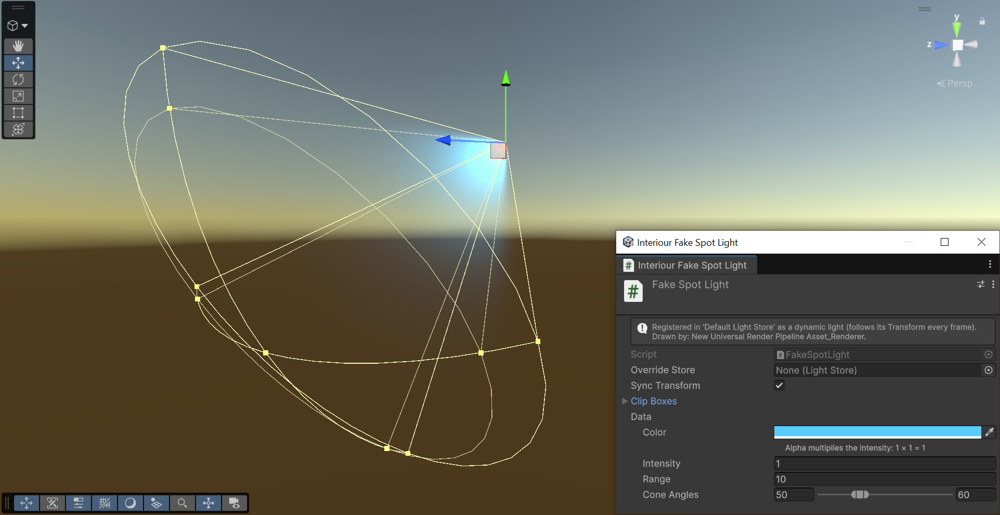

# Fake Spot Light

Component: `FakeSpotLight` (**GameObject > Light > Volumetric > Fake Spot Light**, or **Add Component > Light > Volumetric > Fake Spot Light**)

A standalone fake volumetric spot light: a glowing cone along the GameObject's forward (+Z) axis, drawn by the
Fuluma render feature. It needs no Unity `Light`.



## Overview

The light registers in its store while the component is enabled and the render feature drawing that store draws
it. Aim it like any spot light: it shines along the blue +Z axis from the GameObject's position. In the Scene view,
the selected light shows its cone with handles for the range (the dot on the axis) and the outer and inner angles
(the dots on the cap). The inspector starts with a status box saying where the light is registered and which
renderers draw it.

The glow's brightness is the product of **Intensity**, the color's alpha and the render feature's **Light
Intensity**; all three scale it linearly. The glow fades with distance from the apex and is zero at **Range**.

For a fake light that follows an existing Unity spot `Light`, use [Fake Light (Linked)](LinkedFakeLight.md).

## Properties

| Property | Description | Default | Range | Runtime change |
|---|---|---|---|---|
| Light Settings > Color | Light color. Its alpha is an extra brightness multiplier (0 = off, 1 = full), for example to fade a light without touching its intensity; the line under the field shows the resulting brightness. | White, alpha 1 | RGBA8 | Immediate |
| Light Settings > Intensity | Brightness multiplier (HDR). Stored as a half on the GPU: up to about 65504, with about three significant digits. | 1 | ≥ 0 | Immediate |
| Light Settings > Range | Distance from the apex at which the glow fades to zero and the volume ends. | 5 | ≥ 0 | Immediate |
| Light Settings > Cone Angles | Inner angle (full brightness inside it; the angular falloff starts there) and outer angle (the edge of the volume), as full angles in degrees, on one slider. The inner angle never exceeds the outer one. Cones wider than about 160 degrees need the Wide Cone Precision fidelity feature for exact glow near the axis. | 20 / 30 | 0 to 179.8 | Immediate |
| Override Store | Light store to register the light in. Empty: the default store (`LightStore.Default`). | None | Any Light Store | Re-registers the light |
| Sync Transform | On: the light follows its Transform every frame (dynamic). Off: it is static and moves only when `ApplyTransform()` is called. See [Static vs Dynamic Lights](../README.md#static-vs-dynamic-lights). | Off | | Re-registers the light (new pool) |
| Clip Boxes | Four slots, each a clip box and its role (Keep or Subtract). An empty box leaves the slot unused. The inspector explains under a slot why its box has no effect (another store, disabled, already used). See [Clip Boxes](../README.md#clip-boxes). | All unused | 4 slots | Immediate |

## Scripting

| Member | Description |
|---|---|
| `Data` | The light settings (`SpotLightData`); setting it pushes them to the store at once. |
| `OverrideStore`, `SyncTransform` | As in the Inspector. |
| `ClipBoxes` | The four clip box slots (`ClipBoxSlots`, a struct); assign a changed copy to apply it. |
| `ApplyTransform()` | Copies the current position and rotation into the store (static lights only). |
| `ApplyData()` | Pushes the serialized settings to the store, after changing them by other means than `Data`. |

Fading a light out through its color's alpha:

```C#
using Saesentsessis.Fuluma.Rendering.Components;
using UnityEngine;

public static void SetFade(FakeSpotLight light, float visibility)
{
    var data = light.Data;
    data.Color.a = (byte)Mathf.RoundToInt(Mathf.Clamp01(visibility) * 255f);
    light.Data = data; // Pushed to the store immediately.
}
```

## Notes

- **Static by default.** With Sync Transform off, moving the GameObject from code doesn't move the light until
  `ApplyTransform()` is called. Edits in the Inspector and Scene view apply automatically.
- **Scale is ignored.** A light uses its Transform's position and rotation only; scaling the GameObject doesn't
  resize the cone (use Range and the angles). Clip boxes, by contrast, follow their Transform's scale.
- **Prefab assets** don't register; their instances do, once enabled in a scene.
