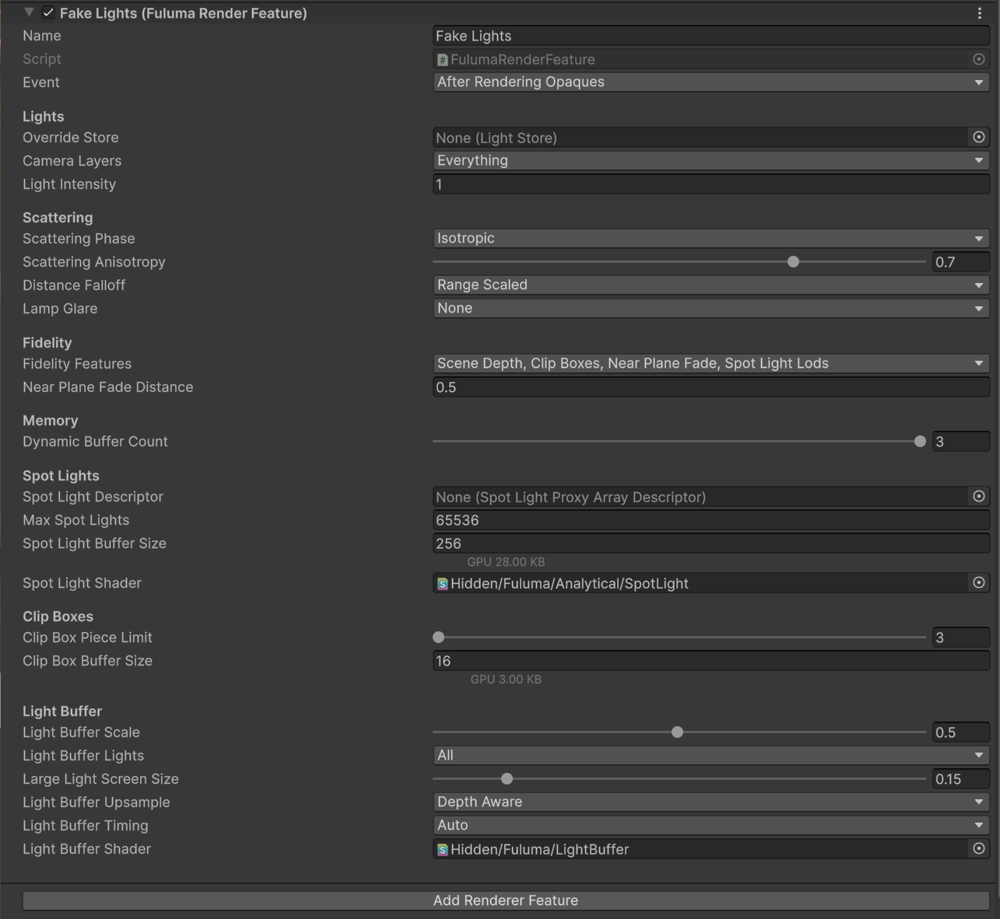

# Fuluma Render Feature

URP Renderer Feature: `FulumaRenderFeature`

The URP renderer feature that culls and draws the fake lights of one light store, at full resolution or through a
downsampled light buffer.



## Overview

Add it to a Universal Renderer (**Add Renderer Feature > Fuluma Render Feature**). Every frame, for every camera
that draws it, the feature culls the lights of its store on worker threads, picks a proxy LOD per light, and draws
them additively with an analytical shader, straight onto the camera or into a downsampled light buffer that is then
upscaled.

- **One store per feature.** The feature draws its **Override Store**, or the default store when that is empty.
  Lights in another store need a feature of their own. See
  [Light Stores & Cameras](../README.md#light-stores--cameras).
- **Camera filter.** A camera draws the lights only if its culling mask includes one of **Camera Layers**.
- **Pass event.** The default, **After Rendering Skybox**, is recommended: the lights read the scene depth the
  opaques leave behind, glow in front of the sky, and transparent objects drawn afterwards blend over the glow behind
  them. **After Rendering Opaques** is fine where no sky shows: URP draws the skybox after it, over any glow in front
  of the sky. **After Rendering Transparents** draws the glow over transparent objects instead, even those in front
  of it, since they write no depth. Events before the opaques have no scene depth to read. A downsampled buffer with
  Before Opaques timing is shaded after URP's depth prepass whatever the event; only its composite runs at the event.

## Properties

| Property | Description | Default | Range | Runtime change |
|---|---|---|---|---|
| Event | When in URP's frame the lights are drawn (see Overview). | After Rendering Skybox | Any `RenderPassEvent` | Applies from the next frame |

**Lights**

| Property | Description | Default | Range | Runtime change |
|---|---|---|---|---|
| Override Store | The store whose lights this feature draws. Empty: the default store, where components register unless they name a store of their own. | None (default store) | Any Light Store | Recreates the pass |
| Camera Layers | Cameras draw the lights only if their culling mask includes one of these layers, as if the lights lived on them. Preview cameras never draw them. | Everything | Any layer mask | Immediate |
| Light Intensity | Global multiplier on the brightness of every fake light the feature draws, whatever its type. | 1 | ≥ 0 | Immediate |

**Scattering**

Each option is its own shader variant; see [Scattering](../README.md#scattering) for how they look and cost.

| Property | Description | Default | Range | Runtime change |
|---|---|---|---|---|
| Scattering Phase | How the haze scatters light toward the camera. Isotropic: equally in every direction, a beam looks the same from every side. Henyey-Greenstein: mostly onward, as real haze does, so beams look faint from the side and bright when looking toward their lamp. | Isotropic | Isotropic, Henyey-Greenstein | Immediate |
| Scattering Anisotropy | With Henyey-Greenstein: how strongly the haze scatters onward (the mean cosine of the scattering angle). 0 scatters equally in every direction; real haze sits around 0.7 to 0.85. It redistributes light without adding any. Above 0.8 the glow toward the lamp gets less accurate (worst view ray off by up to about 14% at 0.8 and a third at 0.9 against an exact integral); the whole range stays available. | 0.7 | 0 to 0.95 | Immediate |
| Distance Falloff | How the glow fades with the distance from the lamp. Range Scaled: inverse square scaled by the light's range, so a light looks the same at any size. Unity: URP's own light attenuation, inverse square in world units with URP's fade toward the range, so intensity means what a Unity Light's does. | Range Scaled | Range Scaled, Unity | Immediate |
| Lamp Glare | How bright a light gets at its lamp. None: the lamp has a small size (2% of the range), keeping the glow next to it finite. Point: a point lamp, glaring where rays pass close to it. | None | None, Point | Immediate |

**Fidelity**

| Property | Description | Default | Range | Runtime change |
|---|---|---|---|---|
| Fidelity Features | Optional parts of the rendering, each trading quality against cost: Scene Depth, Clip Boxes, Near Plane Fade, Wide Cone Precision, Spot Light LODs. See [Fidelity Features](../README.md#fidelity-features) for what each does and costs. | All but Wide Cone Precision | Any combination | Scene Depth and Spot Light LODs recreate the pass; the others apply immediately |
| Near Plane Fade Distance | Distance past the near clipping plane, along the view direction, over which the glow fades in (with Near Plane Fade on). | 0.5 | ≥ 0.001 | Immediate |

**Memory**

| Property | Description | Default | Range | Runtime change |
|---|---|---|---|---|
| Dynamic Buffer Count | GPU buffers that per-frame data (dynamic lights' transforms, dynamic clip boxes) rotates through; each frame writes the next one, so the GPU can still read the frames before. 3 covers a GPU running one to two frames behind; 2 saves memory where it runs at most one frame behind; 1 rewrites a buffer the GPU may still be reading (a stall, or moving lights a frame off), fine without dynamic lights or boxes. | 3 | 1 to 3 | Inspector only; used when the store's GPU buffers are first created |

**Spot Lights**

| Property | Description | Default | Range | Runtime change |
|---|---|---|---|---|
| Spot Light Descriptor | Proxy mesh LODs for spot lights, picked per light by its size on screen. See [Spot Light Proxy Array](SpotLightProxyArrayDescriptor.md). | None (built-in set) | Any Spot Light Proxy Array | Recreates the pass |
| Max Spot Lights | Most spot lights drawn per camera, static and dynamic together. Visible lights past it are skipped, with a warning. | 65536 | ≥ 1 | Immediate |
| Spot Light Buffer Size | Initial capacity, in spot lights, of the store's GPU buffers; they grow when needed. The line under the field shows the GPU memory it allocates. | 256 | ≥ 1 (allocates at least 64, rounded up to a power of two) | Inspector only; used when the store's GPU buffers are first created |
| Spot Light Shader | `Hidden/Fuluma/Analytical/SpotLight`, filled in by the Editor when empty so builds include it. | The package's shader | Shader | Recreates the pass |

**Clip Boxes**

| Property | Description | Default | Range | Runtime change |
|---|---|---|---|---|
| Clip Box Piece Limit | Most pieces a clipped light's ray is integrated in. Each piece costs one more integration on the pixels that have it; past the limit, further pieces merge into the last one (the gaps between them glow). 3 covers rooms with one cut-out; 5 is exact for any four boxes. | 3 | 3 to 5 | Immediate |
| Clip Box Buffer Size | Initial capacity, in clip boxes, of the store's GPU box buffers; they grow when needed. | 16 | ≥ 1 (allocates at least 16, rounded up to a power of two) | Inspector only; used when the store's GPU buffers are first created |

**Light Buffer**

| Property | Description | Default | Range | Runtime change |
|---|---|---|---|---|
| Light Buffer Scale | Resolution the lights are shaded at, as a fraction of the camera's width and height (0.5 = a quarter of the pixels). Below 1 they draw into a smaller buffer that is then upscaled onto the camera. 1 draws straight onto the camera. See [Light Buffer](../README.md#light-buffer). | 0.5 | 0.01 to 1 | Between two values below 1: from the next camera; crossing 1 recreates the pass |
| Light Buffer Lights | All: the buffer shades every light. Large Only: only lights at least Large Light Screen Size on screen, and lights the camera is inside of; smaller lights draw at full resolution (one more pass; consider All on tile-based mobile GPUs). | All | All, Large Only | Recreates the pass |
| Large Light Screen Size | With Large Only: a light's bounding-sphere diameter, as a fraction of the screen height, from which it is shaded in the buffer. | 0.15 | 0.01 to 1 | Recreates the pass |
| Light Buffer Upsample | Depth Aware keeps glow from bleeding over nearer geometry (3 texture reads per pixel, 6 at depth edges); Bilinear is the cheapest (1). | Depth Aware | Depth Aware, Bilinear | Recreates the pass |
| Light Buffer Timing | When a downsampled buffer is shaded: Before Opaques (from URP's depth prepass), After Opaques, or Auto (before only when the renderer's settings already make URP render a depth prepass). | Auto | Auto, After Opaques, Before Opaques | Immediate |
| Light Buffer Shader | `Hidden/Fuluma/LightBuffer`, filled in by the Editor when empty so builds include it. Used only with a downsampled buffer. | The package's shader | Shader | Recreates the pass |

## Scripting

| Member | Description |
|---|---|
| `RenderPassEvent` | The pass event. |
| `OverrideStore` | The store drawn; null means `LightStore.Default`. Reading it never creates the default store. |
| `Store` | The store actually drawn: `OverrideStore`, or `LightStore.Default`. |
| `CameraLayers`, `LightIntensity` | Camera filter and global intensity. |
| `ScatteringPhase`, `ScatteringAnisotropy`, `DistanceFalloff`, `LampGlare` | Scattering settings; each switches the shader variant at once, without recreating the pass. |
| `FidelityFeatures` | All fidelity features as one flags value; changed bits are applied only. |
| `UseSceneDepth`, `UseClipBoxes`, `UseNearPlaneFade`, `UseWideConePrecision`, `UseSpotLightLods` | One fidelity feature each. |
| `NearPlaneFadeDistance`, `ClipBoxPieceLimit`, `MaxSpotLights`, `SpotLightDescriptor`, `SpotLightShader` | As in the Inspector. |
| `LightBufferScale`, `LightBufferLights`, `LargeLightScreenSize`, `LightBufferUpsample`, `LightBufferTiming`, `LightBufferShader` | Light buffer settings. |
| `SpotLightBufferSize`, `ClipBoxBufferSize`, `DynamicBufferCount` | Read-only: the capacities used when a store's GPU buffers are created. |

Pointing the feature at another store, for example one per loaded level:

```C#
using Saesentsessis.Fuluma.Core;
using Saesentsessis.Fuluma.Rendering.URP;
using UnityEngine.Rendering.Universal;

public static void DrawStore(UniversalRendererData rendererData, LightStore levelStore)
{
    if (rendererData.TryGetRendererFeature(out FulumaRenderFeature fuluma))
        fuluma.OverrideStore = levelStore; // Recreates the pass; null draws LightStore.Default again.
}
```

## Notes

- **The renderer must be the one in use.** The feature draws only on the renderers it is added to, so every quality
  level's URP asset (and every renderer a camera may use) needs one. The inspector of every light and clip box warns
  when no renderer draws its store, or when a quality level doesn't.
- **Shaders in builds.** Builds include only referenced shaders. The Editor fills in empty shader fields; a build
  flow that clears them leaves the player without the shaders, and the lights don't draw.
- **Shader variants in builds.** By default a build keeps only the shader variants its features' settings use
  ([Shader Variant Stripping](../README.md#shader-variant-stripping)). Settings that switch a variant (the Scattering
  options and most fidelity features) and are changed from scripts at runtime need those variants kept: list the
  setups in a shader variant collection on Project Settings > Fuluma, or use Custom mode there. Light Buffer Scale is
  safe to change at runtime.
- **RenderGraph only.** URP's Compatibility Mode isn't supported, so the feature draws nothing there. Compatibility
  Mode support is planned.
- **Max Spot Lights.** Visible lights past the limit are skipped, with a warning logged once.
- **Preview cameras** (inspector and asset previews) never draw fake lights.
- **Deferred paths.** With Light Buffer Timing on Auto, Deferred and Deferred+ never use a prepass, so the buffer is
  shaded after the opaques there.
- **Pass rebuilds.** Settings marked "Recreates the pass" rebuild the materials and proxy mesh, so change them on
  events such as a settings menu, not every frame.
