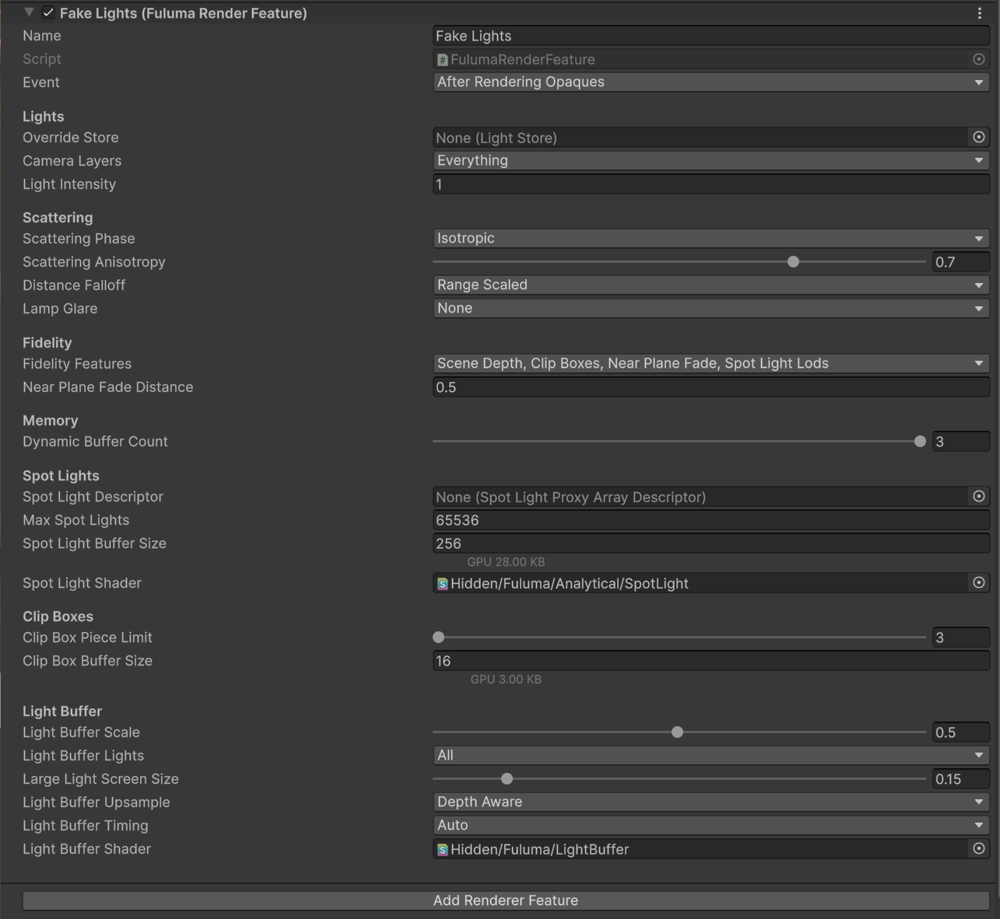
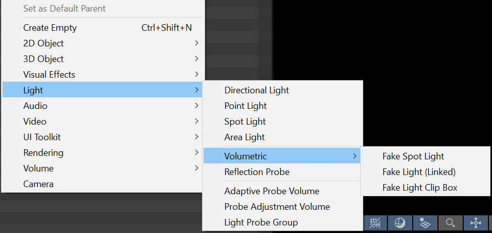
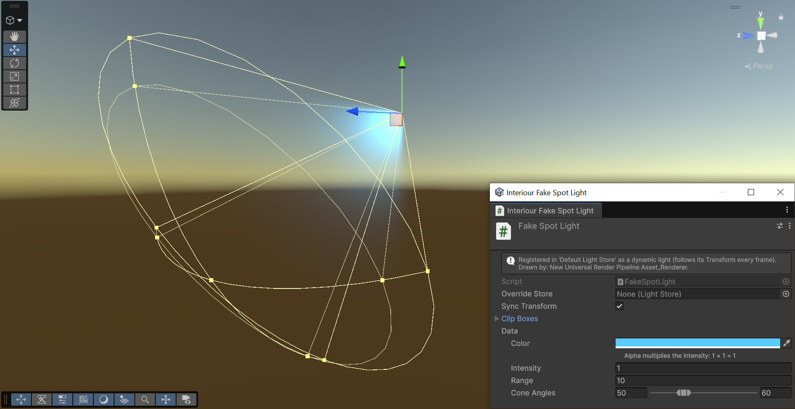
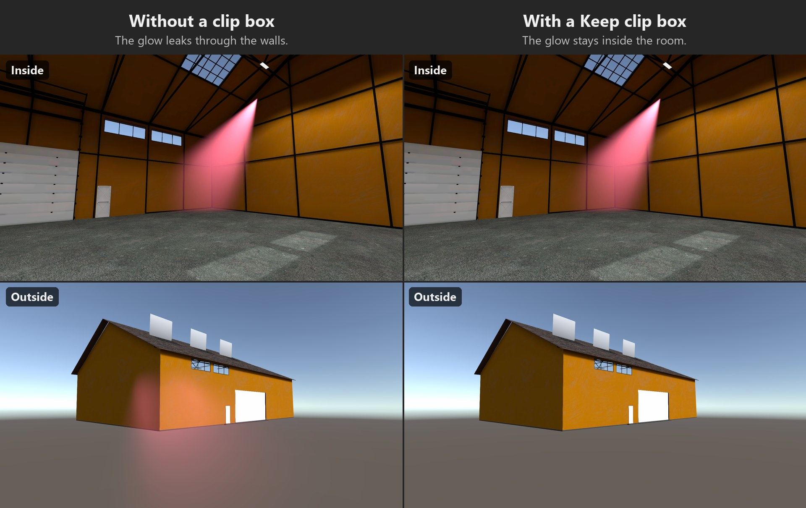
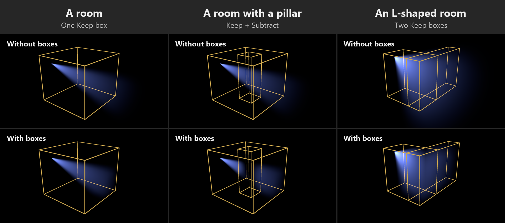
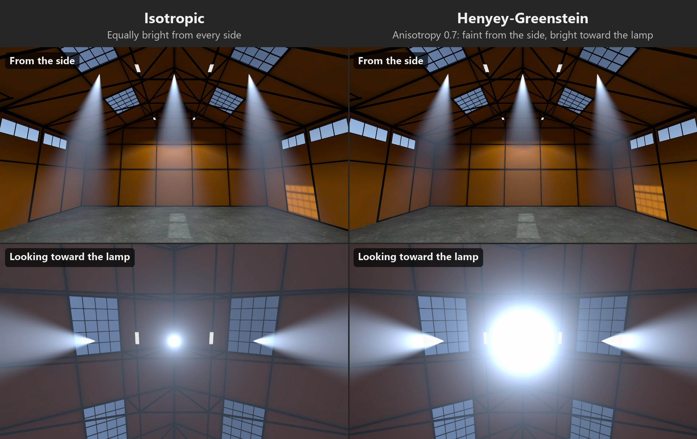
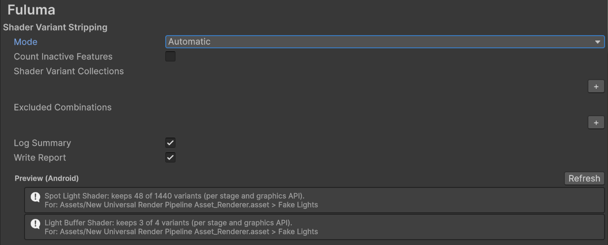

<div align="center">
    <h1>Fuluma</h1>

[](https://openupm.com/packages/com.saesentsessis.fuluma/)
[](https://unity.com/releases/editor/archive)
[](https://unity.com/releases/editor/archive)
[](https://github.com/Saesentsessis/Fuluma/actions/workflows/release.yml)<br/>
[](https://github.com/Saesentsessis/Fuluma/releases)
[](https://github.com/Saesentsessis/Fuluma/stargazers)
[](https://github.com/Saesentsessis/Fuluma/blob/main/LICENSE)

</div>

**Fuluma** (Fake Unity Voluma) is a high-performance, drop-in URP renderer feature that brings cheap analytical (fake)
volumetric light to your scenes: thousands of static and dynamic spot light cones glowing through the air, shaded
analytically instead of ray-marched, mobile first and with desktop support, in every URP rendering path.

## The Problem & The Solution

Fuluma is built for scenes full of lights, static and moving alike: from low-end mobile scenes with hundreds of
lamps to high-fidelity open worlds and cities on desktop, where volumetric light should cost a fraction of what it
usually does. Performance is the package's first priority; measured results are in [Performance](#performance).

- **Problem:** ray-marched volumetrics pay for every covered pixel and every step along the ray, per light, so their
  cost doesn't scale to many lights, least of all on mobile.<br/>
  **Solution:** thousands of lights at once. Each pool and LOD of lights is one instanced draw, Burst culling on
  worker threads picks the visible lights and their proxy LODs per camera, and the GPU copy is updated only where
  lights changed.
- **Problem:** the same budgets have to hold on a budget phone and on a 4K desktop.<br/>
  **Solution:** it scales down. Lights can be shaded into a downsampled light buffer, every costly part of the
  rendering is an optional fidelity feature, and the passes are laid out for tile-based mobile GPUs.
- **Problem:** cheap mesh-based beams don't integrate light along the view ray, so they look flat from many angles
  and often fall apart once the camera is inside the beam.<br/>
  **Solution:** an exact, noise-free glow. The in-scattering along each view ray is integrated analytically per
  pixel (within 1–2% of a brute-force reference), with no raymarch steps and nothing to denoise.
- **Problem:** a beam has to meet the world correctly: the camera walks into it, walls and floors cut it.<br/>
  **Solution:** it works from inside and against depth. A camera inside a cone sees the right glow, the glow stops
  exactly at scene geometry, and clip boxes keep a light inside its room.
- **Problem:** scenes mix thousands of static lights with a few moving ones (vehicles, searchlights), and treating
  every light the same pays for the static ones every frame.<br/>
  **Solution:** static and dynamic lights live in separate pools. Static lights are only culled each frame, never
  re-read or re-uploaded until they change; only dynamic lights are re-read from their Transforms, by jobs off the
  main thread.

|                                 | Raymarched volumetrics                               | Mesh-based fake beams       | Fuluma                                                                                                           |
|---------------------------------|------------------------------------------------------|-----------------------------|------------------------------------------------------------------------------------------------------------------|
| Cost per light                  | Steps × covered pixels                               | One draw, often instanced   | Instanced draws per LOD, one analytic evaluation per pixel                                                       |
| Hundreds to thousands of lights | Rarely affordable                                    | Yes                         | Yes, with culling and proxy LODs                                                                                 |
| Glow quality                    | Physically based; noisy or banded at low step counts | Textured approximation      | Exact for its light model, no noise                                                                              |
| Camera inside the volume        | Yes                                                  | Often breaks                | Yes                                                                                                              |
| Scene geometry                  | Stops at depth                                       | Usually a soft depth fade   | Stops exactly at depth                                                                                           |
| Shadows inside the volume       | Yes, from shadow maps                                | No                          | No (clip boxes limit where light glows)                                                                          |
| Look and per-light styling      | Depends on the implementation                        | Usually the richest options | One analytical model with per-feature scattering options; per light: color, intensity, range, angles, clip boxes |
| Mobile                          | Expensive                                            | Cheap                       | Cheap; downsampled light buffer                                                                                  |

Fuluma has one analytical light model. Its [Scattering](#scattering) settings (phase function, distance falloff,
lamp glare) apply to every light a renderer feature draws; each light's look is then shaped by its color, intensity,
range, cone angles and clip boxes rather than by per-light styling options. Per-light styling and more light models
are on the [roadmap](#upcoming-changes).

## Core Features

- **Lights and authoring**
  - `FakeSpotLight`: a standalone fake spot light with color, intensity, range and inner/outer cone angles.
  - `LinkedFakeLight`: turns an existing Unity spot `Light` into a fake one that follows its color, color
    temperature, intensity, range and angles, every frame or only while editing.
  - Every light is static (placed once, moved on request) or dynamic (follows its Transform every frame).
  - Light stores: lights register in a store, and each renderer feature draws one store, so scenes can split their
    lights between features and cameras.
- **Rendering**
  - Analytical in-scattering: inverse-square falloff with a smooth range cut-off and an inner/outer cone penumbra,
    integrated along each view ray up to the scene depth. No raymarching, no noise, no temporal passes.
  - Correct with the camera inside a cone; a near-plane fade hides the edge the near plane cuts through it.
  - Scattering options: Henyey-Greenstein forward scattering (beams faint from the side, bright toward their lamp),
    Unity's own light falloff (intensity means what a Unity Light's does) and point-lamp glare, each its own shader
    variant.
  - Fidelity features to trade quality against cost: scene depth, clip boxes, near-plane fade, wide cone precision
    (exact glow near the axis of cones wider than about 160°) and proxy LODs.
- **Light buffer**
  - Shade the lights at a fraction of the camera resolution (0.01 to 1) and upscale them bilinearly or depth-aware.
  - Optionally only large lights go through the buffer; small ones stay at full resolution.
  - Optionally shaded before the opaques from URP's depth prepass, which keeps URP's render passes merged on
    tile-based mobile GPUs.
- **Clip boxes**
  - Oriented boxes that limit where lights glow: up to four per light, each Keep (the light exists only inside) or
    Subtract (it is removed inside), exact per pixel. Static or following a Transform.
  - Dedicated shader variants for the common combinations (one box, a room with a cut-out, two rooms, two
    cut-outs), so lights pay only for the boxes they use. More shaping and clipping features are planned.
- **Culling and performance**
  - Burst culling per camera on worker threads, overlapping URP's own culling: an exact cone test, proxy mesh LODs
    by screen size, and lights the camera is outside of drawn with early depth rejection.
  - One instanced draw per pool, pass and LOD; GPU data uploaded only where it changed; dynamic data written through
    rotating buffers by jobs.
  - No managed allocations per frame: native memory, Burst jobs and pooled GPU buffers.
- **Code-first API**
  - `LightStore` adds, moves, changes and removes lights and clip boxes from code, including batched moves of many
    static lights in one Burst job. Components are optional.
- **Editor tooling**
  - Scene view gizmos and handles for range, cone angles and clip boxes, and a combined inner/outer angle slider.
  - An inspector status on every light and box: where it is registered, and which renderers draw its store, with a
    warning when none does.
  - Memory readouts next to every buffer capacity setting.
  - Shader variant stripping on **Project Settings > Fuluma**: builds keep only the variants their render features
    use (or the ones you pick), with a preview and a report per build.

## Key Types

Fuluma is a 0.x preview: following Semantic Versioning, its public API may change between minor versions until 1.0.

**Renderer feature**

| Type                  | Purpose                                                                                                       | Reference                                                                                                                           |
|-----------------------|---------------------------------------------------------------------------------------------------------------|-------------------------------------------------------------------------------------------------------------------------------------|
| `FulumaRenderFeature` | Culls and draws the fake lights of one light store, at full resolution or through a downsampled light buffer. | [Fuluma Render Feature](https://github.com/Saesentsessis/Fuluma/blob/main/Fuluma/Assets/root/Documentation~/FulumaRenderFeature.md) |

**Components**

| Type               | Purpose                                                                   | Reference                                                                                                                      |
|--------------------|---------------------------------------------------------------------------|--------------------------------------------------------------------------------------------------------------------------------|
| `FakeSpotLight`    | A standalone fake spot light along the GameObject's forward axis.         | [Fake Spot Light](https://github.com/Saesentsessis/Fuluma/blob/main/Fuluma/Assets/root/Documentation~/FakeSpotLight.md)        |
| `LinkedFakeLight`  | A fake light that follows a Unity spot `Light` on the same GameObject.    | [Fake Light (Linked)](https://github.com/Saesentsessis/Fuluma/blob/main/Fuluma/Assets/root/Documentation~/LinkedFakeLight.md)  |
| `FakeLightClipBox` | An oriented box that limits where lights glow, as a Keep or Subtract box. | [Fake Light Clip Box](https://github.com/Saesentsessis/Fuluma/blob/main/Fuluma/Assets/root/Documentation~/FakeLightClipBox.md) |

**Assets**

| Type                            | Purpose                                                                                          | Reference                                                                                                                                      |
|---------------------------------|--------------------------------------------------------------------------------------------------|------------------------------------------------------------------------------------------------------------------------------------------------|
| `LightStore`                    | Holds lights and clip boxes in native memory; the code API for adding, moving and removing them. | [Light Store](https://github.com/Saesentsessis/Fuluma/blob/main/Fuluma/Assets/root/Documentation~/LightStore.md)                               |
| `SpotLightProxyArrayDescriptor` | The proxy mesh LODs spot lights are drawn with, picked by screen size.                           | [Spot Light Proxy Array](https://github.com/Saesentsessis/Fuluma/blob/main/Fuluma/Assets/root/Documentation~/SpotLightProxyArrayDescriptor.md) |

## Quick Start

1. Add the render feature to your URP renderer: select the Universal Renderer asset, click **Add Renderer Feature**
   and pick **Fuluma Render Feature**. The defaults draw every light in the default light store.

   
2. Add a light: **GameObject > Light > Volumetric > Fake Spot Light**, then aim it like any spot light (it shines
   along its blue +Z axis). Its inspector shows whether a renderer feature draws it.

   
   
3. Already have Unity spot Lights? Add **Fake Light (Linked)** to them, and they glow with the Light's color,
   intensity, range and angles.

Lights can also be added from code, without components:

```C#
using Saesentsessis.Fuluma.Core;
using Saesentsessis.Fuluma.Data;
using UnityEngine;

var store = LightStore.Default;

// A static light: placed once, moved only when you say so.
var light = SpotLightData.Default;
light.Color = new Color32(255, 214, 170, 255);
light.Intensity = 4f;
light.Range = 8f;
light.InnerAngleDegrees = 20f;
light.OuterAngleDegrees = 40f;

LightHandle lamp = store.AddSpotLight(
    new Placement { Position = new Vector3(0f, 4f, 0f), Rotation = Quaternion.LookRotation(Vector3.down) },
    light);

// A dynamic light: follows a Transform every frame.
LightHandle headlight = store.AddSpotLight(carTransform, light);

// A clip box: the lamp glows only inside its room.
ClipBoxHandle room = store.AddClipBox(
    new Placement { Position = new Vector3(0f, 2f, 0f), Rotation = Quaternion.identity },
    new ClipBoxData { Center = Vector3.zero, Size = new Vector3(6f, 4f, 6f) });
store.SetClipBoxes(lamp, new[] { ClipBoxReference.Keep(room) });

// Handles stay valid until removed (or until the store is released).
store.Remove(headlight);
```

### Advanced

**Moving many static lights at once.** `SetSpotLightPlacements` moves every light in one Burst job:

```C#
using Unity.Collections;

using var handles = new NativeArray<LightHandle>(lampHandles, Allocator.TempJob);
using var placements = new NativeArray<Placement>(newPlacements, Allocator.TempJob);

int moved = store.SetSpotLightPlacements(handles, placements);
```

**Moving static components.** A light or clip box component with **Sync Transform** off is static: move its
GameObject, then call `ApplyTransform()` on it. Turn **Sync Transform** on for components that move every frame.

**A second store and feature.** Create a store (**Assets > Create > Saesentsessis > Fuluma > Light Store**), add a
second Fuluma Render Feature with that store as its **Override Store**, and set the same store on the lights and
clip boxes it should draw (or add them to it from code). With **Camera Layers**, each feature draws only for the
cameras that render its layers, for example a minimap camera.

Almost every render feature setting can also be changed from code, for example from a quality settings menu:

```C#
using Saesentsessis.Fuluma.Rendering.URP;
using UnityEngine.Rendering.Universal;

if (rendererData.TryGetRendererFeature(out FulumaRenderFeature fuluma))
{
    fuluma.LightBufferScale = 0.5f;
    fuluma.UseClipBoxes = false;
    fuluma.LightIntensity = 1.5f;
}
```

## Usage Guide

### Static vs Dynamic Lights

Every light and clip box is either static or dynamic, chosen by **Sync Transform** on its component (or by the
`AddSpotLight` / `AddClipBox` overload from code).

- **Static** (Sync Transform off): placed when it registers and moved only on request: `ApplyTransform()` on the
  component, or `SetSpotLightPlacement` / `SetSpotLightPlacements` / `SetClipBoxPlacement` from code. Between moves a
  static light is only culled; nothing is re-read or uploaded.
- **Dynamic** (Sync Transform on): re-read from its Transform every frame by a job off the main thread, then
  uploaded to the GPU through rotating buffers.

With few lights, dynamic is fine everywhere: up to about 150 dynamic lights should be fine even on mobile. Beyond
that, keep lights static unless they actually move most frames, and move occasional movers with the calls above. As
with every number here, test on your target platforms.

### Light Stores & Cameras

Lights and clip boxes register in a **light store**, and each Fuluma Render Feature draws exactly one store. When
nothing is assigned, components, code (`LightStore.Default`) and features all use the default store, so a single
feature draws everything.

To split lights, create a store asset (**Assets > Create > Saesentsessis > Fuluma > Light Store**) and set it as the
**Override Store** of the lights, the clip boxes and the feature that should draw them. A light uses only clip boxes
of its own store. Every light's and box's inspector shows its store and which renderers draw it, with a warning when
none does or when a quality level doesn't.

- **Per camera group.** A feature draws only for cameras whose culling mask includes one of its **Camera Layers**,
  so a minimap or a second camera can draw its own store through its own feature.
- **Per quality setting.** Different URP assets (one per quality level) can each carry a renderer with its own
  Fuluma feature drawing the same store, for example full resolution on high settings and a downsampled light
  buffer on low ones.

### Clip Boxes

A clip box limits where lights glow, for example to keep a lamp from shining through the walls of its room. Add
one with **GameObject > Light > Volumetric > Fake Light Clip Box**, size it with its handles, then assign it to one
of the four **Clip Boxes** slots of a light, each with a role:

- **Keep**: the light exists only inside its Keep boxes.
- **Subtract**: the light is removed inside the box.



Typical setups:

- **A room**: one Keep box around the room.
- **A room with a pillar**: a Keep box for the room and a Subtract box around the pillar, so the beam doesn't pass
  through it.
- **An L-shaped room**: two Keep boxes, one per wing; the light glows in their union.



Limits and costs:

- Up to four boxes per light, all from the light's store. Boxes are oriented and follow their Transform's rotation
  and scale (statically or, with Sync Transform, every frame).
- Boxes cast no shadows: subtracting a pillar removes the glow inside it, not behind it.
- **Clip Box Piece Limit** (3 to 5) is the most separate pieces a clipped ray is integrated in. 3 covers a room with
  one cut-out; 5 is exact for any four boxes. Each extra piece costs one more integration on the pixels that have it.
- Clip boxes work only while the **Clip Boxes** fidelity feature is on. Lights without boxes keep using the cheapest
  shader, so boxes cost only on the lights that use them. Measured on a Mali-G52 phone (a Mali-G77 in parentheses)
  at full resolution, in the stress scene described under [Fidelity Features](#fidelity-features), compared with the
  same lights without boxes: one Keep box +6% (0%), Keep + Subtract +9% (+3%), two Keep boxes +22% (+14%), two
  Subtract boxes +36% (+24%), three boxes +70% (+47%).

### Light Buffer

**Light Buffer Scale** below 1 shades the lights into a smaller buffer, which is then upscaled onto the camera. The
glow is smooth, so most of it survives; what softens is the edge where it meets geometry. Mobile platforms will
usually want a downsampled buffer. Desktop platforms may too, when the light count is high or a lower fidelity is
acceptable for the project.

- **Upsample**
  - *Depth Aware* (default) compares depths while upscaling, so glow doesn't bleed over nearer geometry: three texture
    reads per pixel, six at depth edges.
  - *Bilinear* is the cheapest, one read per pixel, and lets glow bleed over silhouettes in front of it (5% less
    than Depth Aware on a Mali-G52 with a 0.5 buffer, 3% on a Mali-G77).
- **Lights**
  - *All* (default) shades every light in the buffer.
  - *Large Only* shades only lights at least **Large Light Screen Size** on screen (and lights the camera is inside
    of) in the buffer, and draws small ones at full resolution, where they stay sharp. That costs one more pass;
    on tile-based mobile GPUs, *All* is usually the better choice (in the stress scene with a 0.5 buffer, Large Only
    cost +25% on a Mali-G52 and +16% on a Mali-G77).
- **Timing**
  - *Before Opaques* shades the buffer from URP's depth prepass, so only the composite runs after the opaques. On
    tile-based mobile GPUs, URP's opaque and transparent passes then stay one render pass instead of storing and
    reloading color and depth around the buffer: 2-7% of the frame on Mali. It pays off only when a depth prepass
    exists anyway; without one, URP adds a prepass, which draws every opaque object twice.
  - *Auto* (default) picks Before Opaques when the renderer's settings make URP render a depth prepass (Depth Texture
    Mode "Force Prepass" with a depth texture, or depth priming), else After Opaques. It can't see prepasses that
    other features add (SSAO, depth normals); with those, choose Before Opaques.
  - *After Opaques* always shades the buffer after the opaques.
- **MSAA** makes a downsampled buffer much more expensive on mobile: the buffer can't read a multisampled depth
  attachment, so URP copies the depth to a texture and the buffer reads that copy. In the stress scene with MSAA 4x, a
  0.5 buffer cost 32.1 M GPU cycles per frame on a Mali-G52 against 17.0 M without MSAA; on a Mali-G77, 14.0 M against
  4.7 M, more than drawing the lights at full resolution there (9.7 M). Before Opaques timing, where the buffer reads
  URP's depth prepass, recovered 36% and 64%. With MSAA on mobile, measure both timings, or full resolution.

### Scattering

The **Scattering** settings of the render feature choose the light model. Each option is its own shader variant, so a
project pays only for what it picks. The defaults (Isotropic, Range Scaled, no glare) are the original model.

- **Scattering Phase**
  - *Isotropic* (default): the haze scatters light equally in every direction, so a beam looks equally bright from
    every side.
  - *Henyey-Greenstein*: the haze scatters light mostly onward, as real haze does: beams look faint from the side and
    bright when you look toward their lamp. **Scattering Anisotropy** (0 to 0.95, default 0.7) sets how strongly: 0
    scatters equally in every direction, real haze sits around 0.7 to 0.85. It redistributes light without adding
    any. Above 0.8 the glow toward the lamp gets less accurate: the shader takes a fixed number of samples along the
    ray, and the sharper forward peak outgrows them. Against an exact integral, the worst view ray is off by up to about
    14% at 0.8 and a third at 0.9. The whole range stays available; judge high values by eye.
- **Distance Falloff**
  - *Range Scaled* (default): inverse square scaled by the light's range, so a light looks the same at any size and
    its intensity is relative to that size.
  - *Unity*: URP's own light attenuation, inverse square in world units with URP's fade toward the range. A light's
    intensity then means what a Unity Light's does, which suits **Fake Light (Linked)**.
- **Lamp Glare**
  - *None* (default): the lamp has a small size (2% of the range), which keeps the glow next to it finite.
  - *Point*: a point lamp. The glow keeps growing toward it, so the lamp glares where rays pass close to it, most of
    all when looking into it.

Henyey-Greenstein evaluates the phase function at every integration sample, so it is the one option with a noticeable
cost: +14% on a Mali-G52 (+7% on a Mali-G77) at full resolution and +11% (+4%) with a 0.5 buffer, in the stress
scene described under [Fidelity Features](#fidelity-features). Unity falloff and point glare add almost nothing: at
most +3% and below 1%.



### Fidelity Features

Each fidelity feature trades quality against cost, and all but Wide Cone Precision are on by default. The costs
below were measured in the package's stress scene (1024 lights, 300 occluder boxes) on two phones (Vulkan, MSAA off)
and, for Wide Cone Precision, on a desktop GPU; values on other hardware and in other scenes will differ.

- **Scene Depth**: geometry hides the glow and stops it at surfaces. Off, the lights read no depth and glow through
  everything. It removes the buffer's fixed cost but also every saving from occlusion, so it helps only where little
  occludes the lights: turning it off cost +97% on a Mali-G52 (+74% on a Mali-G77) at full resolution, +58% (+33%)
  with a 0.5 buffer, +19% (+6%) with a 0.25 buffer, and saved 20% (21%) with a 0.1 buffer.
- **Clip Boxes**: lights are limited by their clip boxes; see [Clip Boxes](#clip-boxes) for the costs. Free while the
  store has no boxes.
- **Near Plane Fade**: fades the glow in over **Near Plane Fade Distance** past the near plane, hiding the hard edge
  the near plane cuts through a light the camera is at. Only lights the camera is near or inside of pay for it: in
  the stress scene, where few lights are that close, the difference stayed below 1% on both phones.
- **Wide Cone Precision**: exact glow near the axis of cones wider than about 160 degrees, where the default math
  loses precision. It adds a few instructions to every light: +3% on an RTX 3060, +3-4% on a Mali-G52, +1% on a
  Mali-G77. Off by default; turn it on only with very wide cones.
- **Spot Light LODs**: each light is drawn with a proxy mesh LOD picked by its size on screen. Off, every light uses
  the finest LOD (and culling takes a faster path). In the stress scene, turning them off cost +2% on a Mali-G52
  and under 1% on a Mali-G77, at full resolution and with a 0.5 buffer; culling time didn't change measurably.

### Shader Variant Stripping

Fuluma's shaders have many keyword variants (1440 for the spot light shader). Player builds include only the ones you
need, chosen on **Project Settings > Fuluma**:

- **Mode**
  - *Automatic* (default): keeps what the Fuluma render features of the build's URP assets (every Quality level, and
    the Graphics settings' default) can draw with, plus the variants listed in the **Shader Variant Collections** on
    the page. Turn on **Count Inactive Features** if scripts turn features on at runtime. Settings that scripts change
    at runtime aren't seen: list those setups in a shader variant collection, or use Custom.
  - *Custom*: tick the values to keep for each keyword group; every combination of the ticked values is kept.
    **Import from Automatic** starts from what Automatic would keep.
- **Excluded Combinations** strip what you never use, in both modes: pick a value for some groups (Any for the
  others), and every variant with all of them is stripped.
- **Preview** shows how many variants a build for the active target keeps, without building. After each build, the
  Console gets one summary line per shader and `Logs/ShaderStripping/com.saesentsessis.fuluma.json` a full report.

A feature that reads scene depth keeps both depth paths (full resolution and the downsampled buffer), so changing
**Light Buffer Scale** at runtime still works in builds. If a build draws with a stripped variant, Unity falls back to
another one (and logs an error in development builds). After changing these settings, rebuild asset bundles cleanly:
the change doesn't alter their hashes.



## Performance

Performance is the package's first priority. The measured results, with the full methodology behind them, are in
[Performance](https://github.com/Saesentsessis/Fuluma/blob/main/Fuluma/Assets/root/Documentation~/Performance.md):

- **Mobile GPU**: a budget Mali-G52 phone and a Mali-G77 phone, at full resolution and with downsampled light
  buffers, plus the cost of every buffer option, clip box combination and fidelity feature.
- **Desktop GPU**: 16,384 lights at native 4K on an RTX 3060: light buffer scales, every option and feature, and
  per-pass GPU traces.
- **CPU**: culling up to 65,536 lights, per-frame and per-draw cost on phones, GPU uploads and dynamic clip box syncs.
- **Memory**: GPU and CPU bytes per light and per clip box.

## Technical Deep Dive

How it works under the hood is explained in
[Technical Deep Dive](https://github.com/Saesentsessis/Fuluma/blob/main/Fuluma/Assets/root/Documentation~/TechnicalDeepDive.md):

1. **The light model and the integral**: how the glow along each view ray is computed analytically, without
   raymarching, and how accurate it is.
2. **Proxy meshes, passes and culling**: the cone proxies drawn per light, the passes for lights the camera is
   inside of or outside of, and the Burst culling that picks visible lights and their LODs.
3. **The light store and the GPU mirror**: how lights live in native memory, and how only what changed reaches the
   GPU.
4. **The light buffer and clip boxes**: downsampled shading and upscaling, render pass merging on tile-based GPUs,
   and how clip boxes cut the view ray.

## Platform Support

| Platform / feature                         | Status                  |
|--------------------------------------------|-------------------------|
| URP Forward, Forward+, Deferred, Deferred+ | Verified                |
| Perspective and orthographic cameras       | Verified                |
| MSAA                                       | Verified                |
| Windows, Direct3D 12 (Editor and player)   | Verified                |
| Android, Vulkan (Mali-G52, Mali-G77)       | Verified                |
| Windows, Direct3D 11 (Editor)              | Verified                |
| Android, OpenGL ES 3.x                     | Not supported (planned) |
| XR single-pass instanced                   | Untested                |
| iOS and macOS, Metal                       | Untested                |
| WebGPU                                     | Untested                |
| Consoles                                   | Untested                |

**Verified**: run in the test suite or on a device. **Untested**: no evidence either way. **Not supported**: known
not to work.

Some OpenGL ES 3.x drivers, Mali's among them, give vertex shaders no structured buffers, which Fuluma needs (see
[Hardware Requirements](#hardware-requirements)); there the render feature logs an error and draws nothing. A path
through constant buffers is planned.

## Hardware Requirements

The GPU must support compute shaders and structured buffers in the vertex stage
(`SystemInfo.supportsComputeShaders` and `SystemInfo.maxComputeBufferInputsVertex` of at least 1); without them the
render feature logs an error and draws nothing.

As a practical floor, Fuluma is profiled on a budget phone with a Mali-G51 GPU (Honor 8X), Mali-G52 MC2 GPU
(Xiaomi Redmi 15C) and on a Mali-G77 phone (Xiaomi 11T); on desktop, on an RTX 3060 with an i5-11400F.

## Requirements

- Unity **6000.3** or newer
- [`com.unity.render-pipelines.universal`](https://docs.unity3d.com/Packages/com.unity.render-pipelines.universal@latest) **17.3.0** or newer, with RenderGraph (Compatibility Mode is not supported)
- [`com.unity.burst`](https://docs.unity3d.com/Packages/com.unity.burst@latest) **1.8.25** or newer
- [`com.unity.collections`](https://docs.unity3d.com/Packages/com.unity.collections@latest) **2.6.2** or newer
- [`com.unity.mathematics`](https://docs.unity3d.com/Packages/com.unity.mathematics@latest) **1.3.3** or newer
- [`com.saesentsessis.unity-collections-specialized`](https://github.com/Saesentsessis/Unity-Collections-Specialized) **0.3.0** or newer
- [`com.saesentsessis.unity-meshgen`](https://github.com/Saesentsessis/Unity-MeshGen) **0.2.0** or newer
- [`com.saesentsessis.unity-shaderworks`](https://github.com/Saesentsessis/unity-shaderworks) **0.1.1** or newer

## Installation

### Method 1: OpenUPM (Recommended)

You can install this package via the [OpenUPM](https://openupm.com/) CLI:

```bash
openupm add com.saesentsessis.fuluma
```

Or manually add the scoped registry to your `Packages/manifest.json`:

```json
{
  "dependencies": {
    "com.saesentsessis.fuluma": "0.1.0"
  },
  "scopedRegistries": [
    {
      "name": "OpenUPM",
      "url": "https://package.openupm.com",
      "scopes": [
        "com.saesentsessis"
      ]
    }
  ]
}
```

The `com.saesentsessis` scope also resolves the package's own dependencies (Unity Collections Specialized,
Unity MeshGen and ShaderWorks).

### Method 2: Unity package installer

1. Download the latest `.unitypackage` from [GitHub Releases page](https://github.com/Saesentsessis/Fuluma/releases).
   - _Direct Link:_ [Fuluma-Installer.unitypackage](https://github.com/Saesentsessis/Fuluma/releases/download/0.1.0/Fuluma-Installer.unitypackage)
2. Import the downloaded package into your Unity project.
3. The installer will automatically configure OpenUPM in your `manifest.json` file and install the package dependencies.

### Method 3: Install via Git URL

1. Open Unity and navigate to `Window` -> `Package Manager`.
2. Click on the `+` icon in the top left corner and select `Add package from git URL...`.
3. ```
   https://github.com/Saesentsessis/Fuluma.git?path=Fuluma/Assets/root
   ```
4. Click Add.

You can specify exact release version of this package like this:

```
https://github.com/Saesentsessis/Fuluma.git?path=Fuluma/Assets/root#0.1.0
```

Git dependencies of a git package are not resolved by Unity, so add the three dependency repositories first, the same
way:

```
https://github.com/Saesentsessis/Unity-Collections-Specialized.git?path=Unity-Collections-Specialized/Assets/root#0.3.0
```

```
https://github.com/Saesentsessis/Unity-MeshGen.git?path=Unity-MeshGen/Assets/root#0.2.0
```

```
https://github.com/Saesentsessis/unity-shaderworks.git?path=unity-shaderworks/Assets/root#0.1.1
```

## Upcoming Changes

Rough sketches, not commitments — anything here may change shape or not ship at all.

- [ ] **Fake point lights**, with `LinkedFakeLight` following Unity point lights too.
- [ ] **OpenGL ES 3.x support**, reading light data through constant buffers or data-textures.
- [ ] **Per-light styling and more light models**, beyond the Scattering settings shared by every light of a feature.
- [ ] **More shaping and clipping features** beyond oriented clip boxes.
- [ ] **Samples**: showcase scenes for each feature, and the benchmark scene behind the performance numbers.
- [ ] **GPU culling** (`CullingBackend.PreferGPU` currently falls back to the CPU).
- [ ] **Culling bounds from keep boxes**, so lights confined to a room are culled by the room instead of their whole
  cone.
- [ ] **Batched clipbox/light adds/removes/sets** from native arrays.
- [ ] **More performance-related work** so the overhead on your project from this repository stays minimal.
- [ ] **URP Compatibility Mode support** (RenderGraph only for now).

## Contributing

Pull requests are welcome. Bug reports, bug fixes, performance work, platform findings, tests, typo corrections and
documentation improvements are all appreciated — if it makes the package better, open a PR or an
[issue](https://github.com/Saesentsessis/Fuluma/issues).

A few things that make a PR easy to merge: keep it focused on one change, match the surrounding code style, add
tests for anything with behavior, and note the change in `CHANGELOG.md`. If you are unsure whether an idea fits,
open an issue first and ask — that is cheaper than writing code in the wrong direction.

## License

Licensed under the [MIT License](LICENSE).
